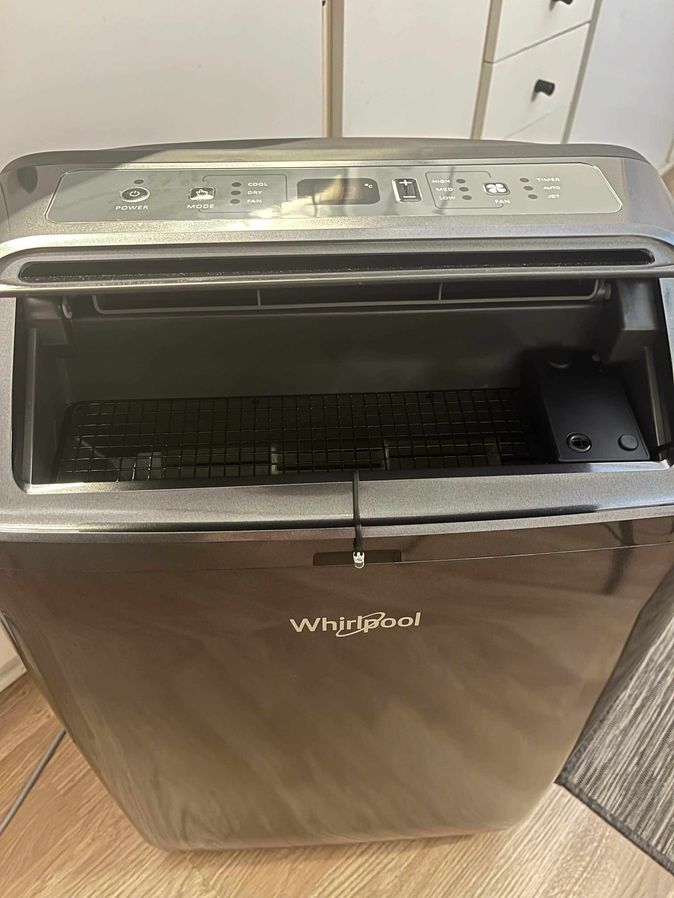
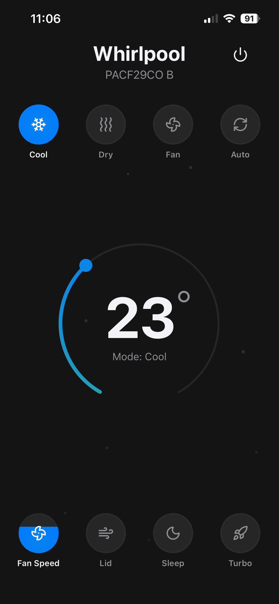
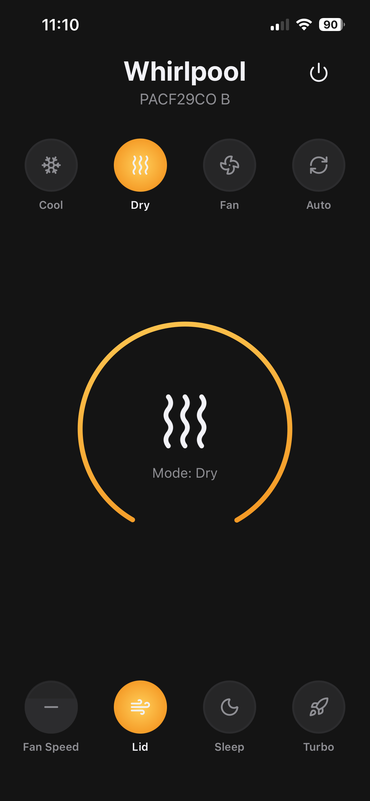
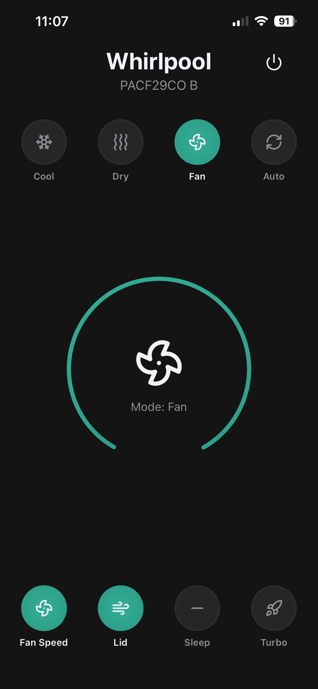
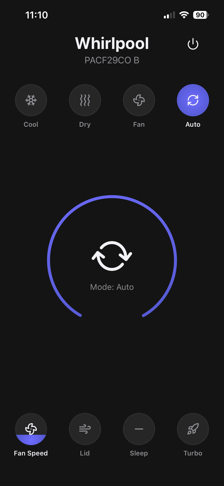
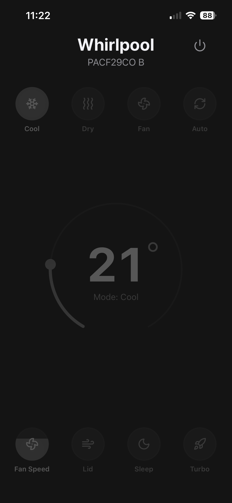
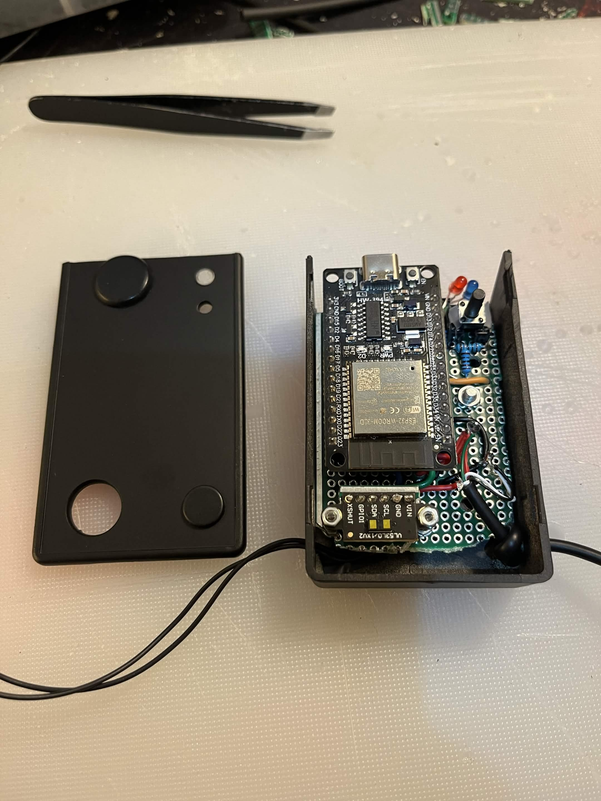
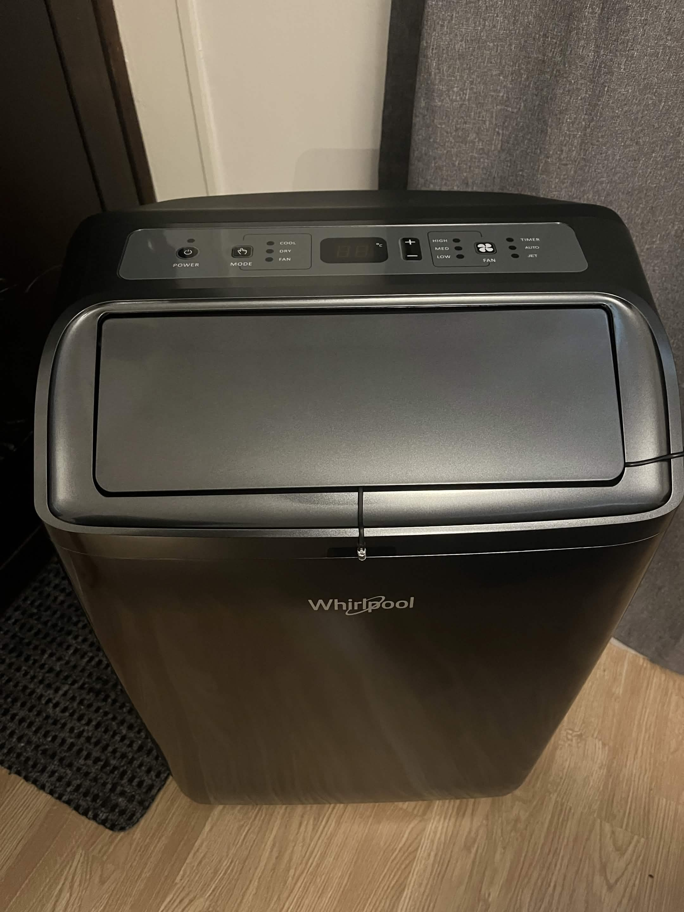

# AC Remote Pwa 

A ESP32 project to control my Whirlpool AC over IR from a web interface.  
Keeps all clients (usually just my phone and desktop) in sync over Websockets.   

> **Note:** This is a personal hobby project.  

## PWA / App

  <video
    src="https://github.com/user-attachments/assets/26912659-2e06-457c-9699-3ccbce801512"
    width="800"
    autoplay
    loop
    muted
    playsinline>
  </video>

## Hardware
Non-invasive install, everything is mounted externally. Let's call it *"good enough"*...   
IR diode is in front of the AC, while the device is to the right.

  

## Features
- IR transmit support for the Whirlpool AC protocol (reverse engineered).
- Time-of-Flight sensor pointed upwards to detect power state and oscillation lid movements.
- Embedded, minified web UI for faster load times (instead of serving raw assets from flash).
- OTA firmware updates, triggered from a physical button on the device.
- Websocket sync for real-time control updates across all client.

## Notes
- IR timing and protocol details are tuned for this specific AC unit.
- Includes a small C# checksum cracker in [CheckSumCracker/](CheckSumCracker/) used during reverse engineering.

 

    
PWA Images

 

Cool

  

Dry

  

Fan

  

Auto

  

Off

  

--- 

    
Hardware Images

 

ESP32

  

AC Closed

  

AC Open

  

